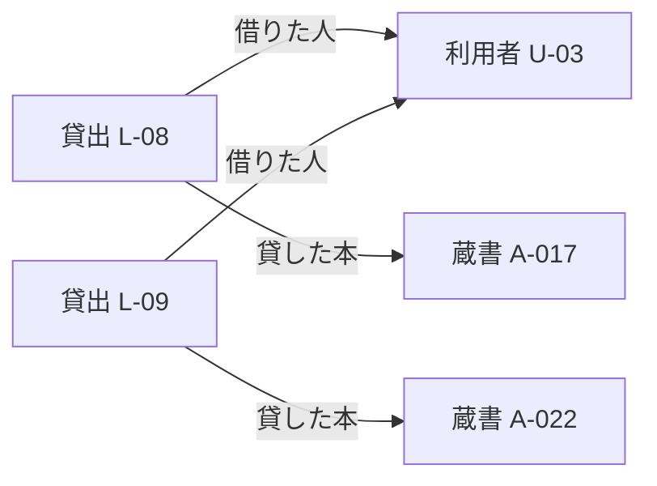

# 第6章：問いからモデルを設計する

更新日：2026-10-11。執筆とレビューの状況は[README](../../README.md)で確認できる。

## この章の到達点

答えたい問いから、必要な対象・関係・条件を選べるようになる。図書室の例を使い、何を一件として扱うか、どこまで知識として保存するかを決める。最後に小さな記録で問いに答え、モデルを見直す。

## 先に、答えの形を決める

図書室の担当者は「貸出を管理したい」と考えている。しかし、この目的だけでは必要な項目が決まらない。現在借りている本を調べるのか、過去の貸出件数を数えるのかで、保存すべき情報が変わる。

モデルが答えるべき具体的な問いを**コンピテンシー・クエスチョン**と呼ぶ。最初は問い合わせ言語で書かず、問い・答えの例・必要な根拠を文章でそろえる。問いを使って範囲を決め、既存の定義を再利用し、例でモデルを直す進め方は、Stanfordの[Ontology Development 101 §3](https://protege.stanford.edu/publications/ontology_development/ontology101.pdf)でも説明されている。

| 問い | 答えの形 | 必要な情報 |
|---|---|---|
| U-03は10月1日10時にどの本を借りているか | 蔵書IDの一覧と貸出ID | 利用者、貸出、蔵書、貸出開始と返却確認の日時 |
| A-017は以前にもU-03へ貸したか | 別々の貸出IDと各期間 | 同じ本・人に対応する過去の貸出 |

本章ではこの二つに範囲を絞る。蔵書の購入価格や印刷工場は扱わない。一方、最初の問いには日時が必要なので、貸出と利用者の線だけでは足りない。漏れなく収録した期間が不明なら、回答にもその範囲を添える。

## 何を一件として扱うか

第4章では、一冊を貸してから返却されるまでの一回を「貸出」とした。本章も同じ単位を使う。三冊を一度に借りる申込みは一件の申込みだが、貸出は三件になる。

この単位の細かさを**粒度**と呼ぶ。一回の貸出に複数冊をまとめると、うち一冊だけ返却された場合の表現が必要になる。一冊ごとに分ければ、貸出ごとに返却確認の日時を持てる。どちらが正しいかは、業務の数え方と問いによって決まる。

図には二冊分の貸出を描いている。U-03が後日A-017を借り直した場合は、新しい貸出を追加する。U-03とA-017を直接つなぐ線一本に上書きすると、過去と現在を分ける材料が失われる。

関係の意味と向きも決める。「借りた人」は貸出から利用者へ、「貸した本」は貸出から蔵書へ向かう。一冊ごとの貸出には、借りた人一人と貸した本一冊を対応付ける。これは教材で採用する定義であり、必要な記載を検査する条件は別途用意する。

## 条件付きの関係を一文に押し込まない

「利用者は三冊借りられる」とだけ書くと、誰にいつ適用する規則か分からない。例えば、教材の別の図書室では次の規則を考えられる。

> 図書室Aの一般利用者には、2026年10月1日以降、同時貸出上限3冊を適用する。受付担当者は貸出確定の直前に冊数を確認する。

これは本章で追加する架空の例である。規則を一つの記録にして、適用する図書室・利用者区分・期間・上限・確認するタイミング・出典を対応付ける。複数の対象が関わる関係を、一つの対象を介して表す考え方であり、貸出を出来事として表した方法と共通する。

例外として職員の上限を変えるなら、一般利用者の規則を適用する範囲と、職員の規則を適用する範囲を定める。同じ人が両区分に属し得る場合には優先順位も決める。例外の文だけを抽出し、元の適用条件を捨てない。

## グラフに残す情報と、必要なときに調べる情報

本の書誌情報や規則は比較的長く使える。一方、現在の貸出状態は操作のたびに変わる。すべてをコピーすると、台帳とグラフのどちらが最新なのかという問題が生まれる。

| 情報 | この教材での置き方 | 理由 |
|---|---|---|
| 蔵書・利用者・規則の識別子と定義 | 知識モデルに保存する | 文書間で対象を対応付けるため |
| 規則の本文と根拠位置 | 原本を残し、知識モデルから参照する | 条件の確認と改訂に戻れるため |
| 貸出確定直前の冊数 | 台帳を問い合わせる | 更新頻度が高く、古い値で判断できないため |
| 過去の状態を再現するための記録 | 対象日時と取得範囲を付けて保存する | 後から同じ条件を確認するため |

外部参照には、取得先だけでなく対象ID・取得日時・収録範囲を対応付ける。台帳が停止した場合の保留や再試行も利用側で決める。グラフから参照先が分かることと、その時点の値を取得できることは別である。

## 既存の語彙を使う

書名や由来の表現まで毎回独自に定義する必要はない。既存の語彙が目的に合えば、他のデータとの対応を共有しやすくなる。例えば[PROV-O](https://www.w3.org/TR/prov-o/#starting-point-terms)は、文書などのもの、作成や抽出の活動、それに関わる人やシステムの由来を表せる。詳細は第8章で使う。

再利用するときは、語の名前ではなく定義と使用例を読む。自分たちの「資料」と外部語彙の「資料」が同じ範囲とは限らない。語彙の版、利用条件、必要な推論への対応も確認する。合わない部分は独自定義を残し、対応する範囲だけを明示する。

## 同じ概念モデルをPGとRDFへ写す

第3章のPGとRDFは保存・記述の表現が違う。概念設計の後では、問いに必要な情報を落とさずに各方式へ写せるかを確かめる。この対応付けを**写像**と呼ぶ。

| 概念モデルの内容 | PGでの表現案 | RDFでの表現案 |
|---|---|---|
| 貸出L-08という出来事 | 貸出のノード | L-08を指すIRIを主語にした記述 |
| L-08で貸した本はA-017 | 貸出から蔵書への関係 | L-08・貸した本・A-017のトリプル |
| L-08の開始日時 | 貸出ノードの属性 | L-08・開始日時・日時の値のトリプル |

出典付きの関係には、もう一つ対応が必要になる。例えば「L-08で貸した本はA-017」という一つの主張にC-01というIDを付ける。C-01へ、主語L-08・関係名「貸した本」・相手A-017・出典「台帳v1の8行目」をまとめる。

PGではC-01をノードにし、L-08とA-017への関係、関係名と出典の属性を持たせられる。RDFではC-01を指すIRIを用意し、同じ四つの内容をそれぞれトリプルで表せる。出典をL-08全体へ付けるより、どの記述の根拠かを区別しやすい。主張を記録することと、その内容を事実として採用することは分け、確認状態も管理する。次の二章でその手順を扱う。

これらは設計案であり、実行用の構文ではない。変換するときはC-01のIDと四つの対応が残っているかを確かめる。技術的な表現は第9章で扱う。

## 小さな記録で合意を確かめる

モデルの図を担当者へ見せるだけでなく、冒頭の問いを一緒に解く。L-08は9月30日に開始し、10月2日に返却確認したとする。この記録なら、10月1日10時にはA-017を貸出中として含める。10月2日の返却確認後の問いには含めない。

貸出台帳の担当者には「返却確認の日時は実際の返却時刻か、台帳へ記録した時刻か」を確認する。利用側には「過去日時の問いに答える必要があるか」を確認する。双方の合意を、定義・例・除外した範囲として残す。

二つ目の問いには、U-03とA-017に対応する別の貸出があるかを調べる。例えば9月1〜3日の貸出L-07も収録されていれば、そのIDと期間を答えられる。履歴が9月30日以降だけなら、それ以前の貸出の有無は不明と答える。

問いに答えられないときは、足りない関係や値を追加する。使わない項目は削る。新しい項目が増えるたびに、どの問いのために必要か説明できれば、モデルを必要以上に大きくせずに済む。

## 復習

- 「貸出を管理したい」を具体的な問いへ変えると、何が決めやすくなるか。
- 申込み一件と貸出一件の単位を分ける理由は何か。
- 現在の貸出冊数を外部参照するとき、ID以外に何を確かめるか。

## 演習と解答例

### 演習1：返却を一冊ずつ扱う

U-20は三冊を一度に借り、その翌日に一冊だけ返した。担当者は「現在借りている本」と「この申込みで借りた本の総数」の両方を調べたい。

何を一件として識別し、どんな対応と日時を保存すればよいか。申込みと貸出を同じ一件にした場合の困りごとも説明しよう。

解答例：申込みに一つのIDを付け、一冊ごとの三件の貸出へ対応付ける。各貸出に蔵書・利用者・開始日時・返却確認日時を残す。現在の本は返却状況から、申込み全体の冊数は対応する三件から調べる。一件の貸出に三冊と返却日時一つだけを置くと、一冊だけ返した状態を区別できない。

### 演習2：語彙を選ぶ

別の図書室の語彙に「貸出」という語があるが、定義は「一度の受付で貸した資料のまとまり」である。自分たちは一冊ごとの貸出履歴を管理したい。

同じ名前だからその語をそのまま採用してよいだろうか。再利用するなら何を決める必要があるか。

解答例：数える単位が違うので、そのまま同じ意味として使えない。外部の貸出を自分たちの申込みに対応付けるか、一冊ごとの貸出を別に定義する。複数冊の例で対応が保たれるかを確認してから採用する。

前：[第5章](05-reasoning-and-constraints.md) ／ 続き：第7章「文書・データ・コードから知識を構築する」
