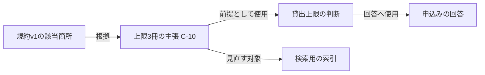

# 第8章：知識の品質とライフサイクル

更新日：2026-10-11。執筆とレビューの状況は[README](../../README.md)で確認できる。

## この章の到達点

知識の根拠と確認状態を記録し、原本の改訂や撤回が回答へどう影響するかを説明できるようになる。公開した後も、品質検査・再計算・担当者の確認を繰り返す運用を考える。

## 根拠のある主張として管理する

図書室の規約v1に「一般利用者の同時貸出上限は3冊」とある。抽出結果を単に「上限＝3」と保存すると、誰に適用する値か、どの規約から得た値かを後から確認できない。

第6章で使った主張の記録を、規則の例へ広げる。次は教材用の項目であり、標準仕様の必須項目ではない。

| 項目 | 記録例 |
|---|---|
| 主張IDと内容 | C-10：図書室Aの一般利用者の同時貸出上限は3冊 |
| 原文位置 | 規約v1、第3節、表2の一般利用者の行 |
| 得た方法 | 原文に明記。表をパーサで抽出 |
| 確認状態 | 担当者が原文と照合し、承認済み |
| 適用する期間 | 2026年10月1日から。終了日は未確定 |
| 取得・確認の記録 | 取り込み日時、抽出器の版、承認者と承認日時 |

適用開始日が原文にない場合は、未確認として残す。取り込み日時を適用開始日へ代用しない。規約を10月5日に取得しても、規約自体は10月1日から有効かもしれない。

このように、どの情報から、誰が、どう作ったかを追える記録を**来歴**と呼ぶ。[W3C PROV-O](https://www.w3.org/TR/prov-o/#starting-point-terms)には、文書などの実体を表すEntity、抽出や確認などの活動を表すActivity、担当者やシステムを表すAgentがある。これらを使い、規約v1を使った抽出活動がC-10を生成し、担当者が確認したという対応を記述できる。

## 明記・導出・推測と、承認状態を分ける

LLMが提案した内容でも、原文と一致すると確認できれば採用できる。ただし、LLMを使ったかどうか、原文に書かれているかどうか、承認済みかどうかは別の情報である。

| 軸 | 区分の例 | 何を答えるか |
|---|---|---|
| 内容の根拠 | 原文に明記／規則から導出／推測候補 | なぜこの内容を述べられるか |
| 作成方法 | パーサ／静的解析／LLM／手入力 | どう取り出したか |
| レビュー状態 | 未確認／承認／却下 | 利用してよいと誰が確認したか |
| 有効性 | 現行／将来適用／失効／撤回 | 指定日時や版に使えるか |

例えば、LLMが表から上限3冊を抽出し、担当者が原文と照合した記録は「原文に明記・LLMで抽出・承認」である。「LLMなので推測」と一律に扱う必要はない。一方、原文にない例外を担当者が案として承認しても、元の規約に明記された事実へ変わるわけではない。提案を正式な規約に採用する手続きとは区別する。

## 品質を検査する

品質検査では、データの形と内容の妥当性を分ける。例えば、主張に出典IDがあることは機械で検査できる。その出典が主張を支えるかは、原文と照合する必要がある。

| 問題 | 検出の手がかり | 確認すること |
|---|---|---|
| 欠落 | 承認済み主張に根拠位置がない | 出典を追加するか、承認を取り消すか |
| 重複 | 同じ対象・関係・値・適用範囲の主張が複数ある | 別の根拠として残すか、同じ取り込みの重複か |
| 矛盾 | 同じ期間・利用者区分に上限3冊と5冊がある | 改訂、例外、抽出誤りのどれか |
| 古い導出 | 導出が失効した規則を参照する | 現行の規則で再計算した結果は何か |

異なる期間の上限3冊と5冊は、そのまま矛盾とは言えない。同じ対象の同じ期間について述べているかを先に確認する。担当者は矛盾の片方を自動で消すのではなく、根拠と適用条件を調べる。

## 改訂・削除・再計算

規約v2で上限が4冊へ変わったとする。v1を直接書き換えると、以前の回答がなぜ3冊としたかを追えなくなる。v1の記録を残し、v2の主張と適用期間を追加する。

図の矢印は依存関係を示す。規約を改訂したら、C-10の適用期間を見直し、C-10を使う判断・回答・索引を更新する。以前の日時を再現する回答と、現行の規約による回答を混ぜない。

根拠が撤回された場合も、対象や関係を即座に全削除するとは限らない。同じ内容を支える別の有効な根拠があれば、その根拠を確認する。導出には使った前提の組を残す。一つの前提が無効になれば、その組による導出は無効になるが、別の前提の組から同じ結論を導ける場合もある。

最初は、選んだ原本の版から全件を作り直す方法が分かりやすい。量が増えて差分更新へ進む場合は、削除・撤回・索引更新も対象にする。追加だけを処理すると、古い関係や回答候補が残る。

公開する単位もそろえる。例えば原本v2、語彙v3、抽出器v1で作った知識と索引を「公開版R-02」としてまとめる。切替えに失敗した場合に前の公開版へ戻せるようにする。これは運用例であり、すべてのシステムで同じ版番号が必要という意味ではない。

## 誰が管理し、誰へ見せるか

規約の正しさを確認する担当者と、取り込み処理を保守する担当者は役割が違う。規約の管理者は内容と適用範囲を確認し、構築担当者は抽出・照合・検査・再構築を担当する。利用側の担当者は、回答に必要な版と品質を決める。小規模なら同じ人が兼任してもよいが、確認する仕事は分けて記録する。

アクセス制御は、原文だけでなく主張・索引・導出・回答へ引き継ぐ。例えば非公開の利用者情報を原文から除外しても、その人の貸出を推測できる関係が公開索引に残れば、意図した制限にならない。検索時に利用者が参照できる根拠だけを選び、生成した回答にもその範囲を守らせる。

原本の権限変更や削除を、索引と回答のキャッシュへ反映する期限も決める。キャッシュは以前の結果を再利用する仕組みである。利用停止すべき結果を再利用しないために、公開版と権限の変化を確認する。

## 復習

- 原文に明記されていることと、承認済みであることを分ける理由は何か。
- 同じ対象の上限3冊と5冊が、必ずしも矛盾ではないのはなぜか。
- 原本の撤回時には、グラフ以外のどこを見直すか。

## 演習と解答例

### 演習1：根拠が一つ消えた

主張C-20は、規約の本文S-1と運用通知S-2を根拠にしている。S-1だけが撤回された。C-20を前提にした回答と、検索索引も保存されている。

C-20をすぐ削除してよいだろうか。更新手順を考えよう。

解答例：S-2が同じ適用範囲でC-20を支えるかを確認する。有効な根拠として残るなら、S-1を撤回済みにし、C-20の根拠を更新する。支えられないならC-20を利用対象から外す。どちらの場合も、導出の前提、保存した回答、索引を見直し、撤回されたS-1だけを根拠にする結果が現行回答へ残らないようにする。

### 演習2：二つの日時

10月5日に取得した規約には「上限4冊は11月1日から適用」とある。利用者は10月20日の上限を尋ねた。

取得日時と適用日時のどちらを使って規則を選ぶか。以前の規則が見つからない場合も考えよう。

解答例：問いの対象日時である10月20日に適用する規則を選ぶ。11月1日からの上限4冊はまだ使わない。10月5日の取得は来歴として残す。以前の規則がなければ、10月20日の上限はこの資料だけでは確定できないと答え、確認する原本を示す。

前：[第7章](07-knowledge-construction.md) ／ 続き：第9章「データモデル・標準・問い合わせ言語」
