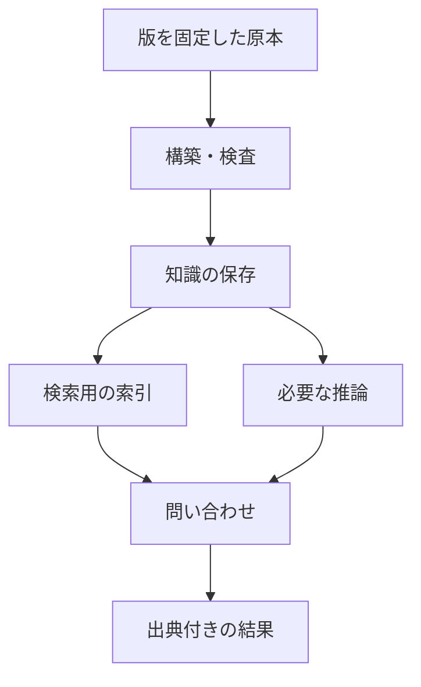

# 第10章：保存・問い合わせ基盤

更新日：2026-10-11。執筆とレビューの状況は[README](../../README.md)で確認できる。

## この章の到達点

知識を保存する場所と、検索・推論を行う処理を分けて構成できるようになる。小さなファイルから専用DBまでを比較し、利用人数・更新・運用の条件に合う出発点を選ぶ。

## 保存・索引・問い合わせ・推論

第9章では、ファイルをPythonのメモリへ読み込み、問い合わせた。読み込んだグラフが大きくなる場合や、複数の利用者が同時に更新する場合は、保存と提供の仕組みを考える必要がある。

| 役割 | 行うこと | 図書室の例 |
|---|---|---|
| 保存 | 再起動後も記録を保持する | 貸出と原本の版を残す |
| 索引 | 条件に合う記録を探すための構造を作る | 利用者IDから貸出を探しやすくする |
| 問い合わせ | 指定した条件に一致する記録を返す | U-03の貸出と書名を取得する |
| 推論 | 定義と事実から帰結を導く | 印刷書籍を印刷資料にも分類する |

索引は保存した記録から作る検索用の構造であり、原本の代わりではない。規則を改訂したときには、保存した主張だけでなく索引や導出済みの結果も更新する。第8章の公開版管理がここでも必要になる。

これは役割の図である。一製品が複数の役割を担当してもよい。推論をあらかじめ行って保存するか、問い合わせ時に行うかも構成によって変わる。推論が不要な問いなら、その処理は省ける。

## DBとライブラリの違い

**グラフDB**は、グラフとしての保存と問い合わせを提供するDBである。PGを扱う製品やRDFを扱う製品があり、RDFの保存・検索基盤は**RDFストア**とも呼ばれる。名称だけで、両方のモデルやすべての推論に対応すると判断しない。

一方、**ライブラリ**は、プログラムへ組み込んで処理を呼び出す部品である。第9章のRDFLibはその例になる。ライブラリで問い合わせができても、それだけで利用者認証、同時更新、バックアップ、公開用APIがそろうわけではない。アプリケーション側で用意する範囲を見積もる。[RDFLib公式リポジトリ](https://github.com/RDFLib/rdflib)

Apache Jenaには、RDF処理のAPI、SPARQL処理、永続化するTDB2、HTTPで問い合わせを受けるFusekiなどがある。「Jenaを使う」だけで構成を終えず、どの部品をどの役割に使うか決める。[Apache Jena Documentation](https://jena.apache.org/documentation/)

## 代表的な構成を比べる

次は構成を考えるための例であり、採用順位ではない。製品の機能・提供条件は変わるため、導入時には対象版を固定して確認する。

| 構成例 | 主なモデル・問い合わせ | 設計で確認する点 |
|---|---|---|
| Neo4j | PG・Cypher | ノードや関係の設計、索引、権限、必要な機能の提供条件 |
| JanusGraph | PG・Gremlin | 保存バックエンドと索引バックエンドの組合せ、運用対象の数 |
| Ontotext GraphDB / Stardog | RDF・SPARQLを中心とする基盤 | 推論・検査の設定と対応範囲、既存データの接続方法 |
| Apache JenaのTDB2＋Fuseki | RDF・SPARQL | 保存とHTTP提供の構成、認証・バックアップの運用 |
| Amazon Neptune | PGのGremlin・openCypher、RDFのSPARQL | 選んだモデル・API、サービス側の制限、ネットワークと課金 |

製品の説明は各公式資料を参照した。[Neo4j](https://neo4j.com/docs/getting-started/)、[JanusGraph](https://docs.janusgraph.org/)、[GraphDB](https://graphdb.ontotext.com/documentation/11.5/)、[Stardog](https://docs.stardog.com/)、[Amazon Neptune](https://docs.aws.amazon.com/neptune/latest/userguide/intro.html)。この章では各製品へデータを投入する比較実験は行っていない。

同じ「SPARQL対応」でも、問い合わせの拡張、推論の設定、データ投入のAPIは異なり得る。第9章の小例だけでなく、利用したい更新と削除、権限、出典の取得まで試して移行できるか確かめる。

JanusGraphの**バックエンド**は、保存や索引を支える構成部品である。例えば保存にCassandraを使い、全文検索などにElasticsearchを追加する構成がある。通常の複合索引は保存側で扱えるため、すべての検索に別の索引サービスが必要なわけではない。追加する部品ごとに更新・監視・復旧の担当を決める。[保存バックエンド](https://docs.janusgraph.org/storage-backend/)、[索引バックエンド](https://docs.janusgraph.org/index-backend/)

## マネージドサービスとセルフホスト

**マネージドサービス**では、提供元が基盤の運用の一部を担当する。**セルフホスト**では、自分たちがサーバーやDBを配置して管理する。どちらでもモデルと原本の意味を確認する仕事は残る。

例えば、DBのバックアップ機能を提供元が運用していても、原本文書と索引を含めてどの公開版へ戻すかは利用側が決める。逆にセルフホストなら、DBだけでなくOS、更新、監視、復旧まで担当できるかを確認する。

比較では、月額費用だけでなく初期構築・保守・障害対応・取り出し費用も含める。外部へ置ける情報の範囲、アクセス経路、利用停止時に標準形式で取り出せるかも、構成の条件になる。

## RDBやファイルから始める選択

図書室Aだけを対象に、二人の担当者が週一回確認するなら、版管理したTurtleファイルと検査プログラムで始める案がある。既存RDBに貸出データがあり、固定した結合で問いに答えられるなら、その表とSQLを利用する案もある。

専用DBへ移す判断には、問い合わせの変化、データ量、同時更新、回答時間、運用担当者を使う。「関係がある」という理由だけでは、追加の基盤を保守する費用を説明できない。

| 確認する条件 | 試す小さな検証 |
|---|---|
| 問いが関係の連鎖をたびたび変える | 実際の問いを三つ用意し、追加・修正に必要な作業を比べる |
| 更新と検索が同時に起こる | 更新途中の不完全な版を読まない構成を試す |
| 回答時間に上限がある | 想定する量・同時利用・索引設定で測定する |
| 基盤を交換する可能性がある | データと出典を取り出し、別環境へ再投入する |

選定の結果は「何を満たしたか」と一緒に残す。機能表の丸印だけでは、手元の問いや運用で使えることを示せない。比較の設計は第16章で扱う。

## 復習

- 索引を作ることと推論を行うことは、何が違うか。
- RDFLibの小例が動いた後、複数人へ公開するには何を追加で考えるか。
- 専用DBへ移す判断には、どのような実測が必要か。

## 演習と解答例

### 演習1：部品を割り当てる

版管理したRDFを夜間に更新し、日中は社内の利用者が問い合わせる。構築処理、保存、問い合わせ提供、公開版の切替えを誰が担当するか考えよう。Jenaを使う場合も、部品名だけで回答を終えないこと。

解答例：構築処理が次の版を作り、検査後にTDB2へ投入する。Fusekiでそのデータへの問い合わせを提供する。運用担当者は原本・知識・索引を含む公開版を切り替え、問題時の復旧を確認する。構築途中の版を利用者へ見せない方法と、認証・権限も決める。

### 演習2：導入しない判断

既存RDBの二つの表を結合すれば、必要な三つの問いに答えられる。問い合わせの変更は少なく、運用担当者は一人である。グラフDBを採用する前に何を比較するか。

解答例：SQLでの対応工数と回答時間を基準にし、グラフDBで同じ問い・更新・復旧を試す。追加の構築・学習・保守費用を含め、必要な改善が得られなければRDBを継続する。将来の可能性だけで現時点の効果を確定しない。

前：[第9章](09-models-and-languages.md) ／ 次：[第11章 編集・構築・推論・検証のツール](11-editing-and-validation-tools.md)
