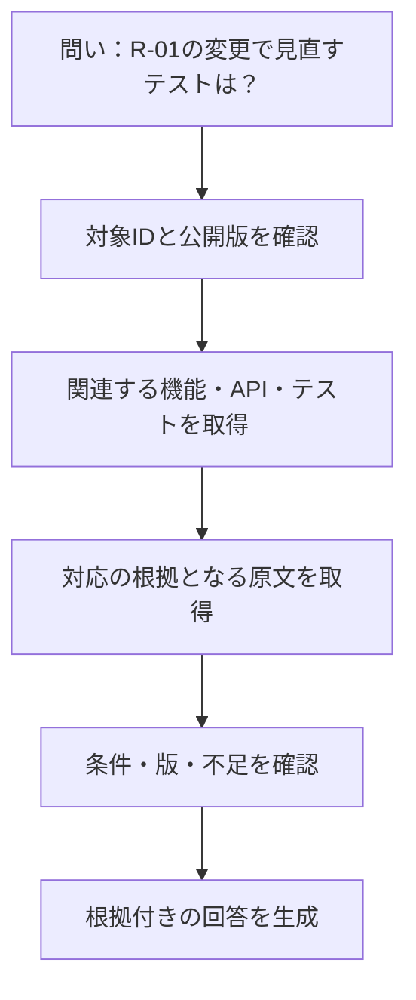

# 第12章：AI・AIエージェント向けの知識活用技術

更新日：2026-10-11。執筆とレビューの状況は[README](../../README.md)で確認できる。

## この章の到達点

全文検索・ベクトル検索・グラフ検索を、問いに合わせて組み合わせられるようになる。取得した知識と原文をAIの回答へ渡す流れを理解し、検索・判断・操作をそれぞれ確認する。

## 同じ問いを三つの検索で考える

第3章の要件R-01、機能F-01、API A-01、テストT-01の対応を使う。「R-01を変更したら、どのテストを見直すか」という問いを考えよう。

| 方法 | 探し方 | 得られる材料と不足しやすい点 |
|---|---|---|
| 全文検索 | R-01や用語を含む文章を探す | 明記された箇所に戻れる。別名や、IDが書かれていない関連文書は別途照合する |
| ベクトル検索 | 文章の特徴を数値の列に変換し、近いものを探す | 言い換えを含む候補を集める。類似度だけでは同一対象や正しい対応と確定できない |
| グラフ検索 | R-01から型付きの関係をたどる | F-01、A-01、T-01を対応付ける。関係が未登録なら、その候補は探索から漏れる |

ベクトル検索で使う数値の列を**埋め込み**と呼ぶ。検索結果は意味の近い候補であり、規則の適用条件や版が一致する保証ではない。IDの一致、原文、公開版などで候補を絞る。

三つを組み合わせる**ハイブリッド検索**なら、全文やベクトル検索で入口を探し、グラフで対応を広げ、原文で内容を確かめられる。すべての問いで三方式を使う必要はない。R-01というIDが分かるなら、IDから直接たどる方が簡潔な場合もある。

## 検索結果から回答を作る

**RAG**（Retrieval Augmented Generation）は、検索で取得した情報を使って生成する構成である。**GraphRAG**という呼び方では、グラフの関係やグラフから作った要約などを検索・生成に使う。単一の固定手順を表す名前ではなく、実装の処理を確認する必要がある。

対応の根拠を設計書v2とテスト仕様v1で確認したとする。回答例は「R-01からF-01、A-01へたどり、A-01を検証するT-01を逆向きに探すと、T-01が見直し候補になる。根拠は設計書v2の該当節とテスト仕様v1のT-01」である。これは変更影響の候補であり、実際の変更内容を確認する前にテストの修正要否まで確定しない。

回答に出典名を添えるだけでは、根拠が結論を支えているか分からない。対応関係の根拠と、そこから述べた結論を結び付ける。原文にない条件を要約が補っていないかも確認する。

## GraphRAGの実装を読み分ける

MicrosoftのGraphRAGは、原文からグラフを作り、関連する対象の集まりであるコミュニティとその要約を使う構成を提供する。全体の傾向を尋ねる検索と、特定の対象の周辺を尋ねる検索などを分けている。[Microsoft GraphRAG Documentation](https://microsoft.github.io/graphrag/)

Neo4jのGraphRAG Pythonには、ベクトル検索、全文検索との組合せ、検索した対象からCypherで周辺を取得する部品などがある。検索を担当する部品は**Retriever**と呼ばれる。[Neo4j GraphRAG Python User Guide](https://neo4j.com/docs/neo4j-graphrag-python/current/user_guide_rag.html)

LlamaIndexにも、プロパティグラフの構築と検索をつなぐ仕組みがある。どの部品を使う場合も、対象ID、原文位置、適用版、検索結果の形式を構築側と利用側で合わせる。[LlamaIndex Property Graph Index Guide](https://developers.llamaindex.ai/python/framework/module_guides/indexing/lpg_index_guide/)

比較するのは名前ではなく、必要な問いに対する取得内容、原文へ戻れるか、更新の方法、生成までの費用である。本章は公式資料に基づく構成の紹介であり、各実装の回答品質を実測したものではない。

## コード理解とエージェントの記憶

**Graphify**は、コードや文書などから関係を取り出し、問い合わせや可視化へ使う道具の一例である。指定サイトの[Graphify案内](https://graphify.net/skills/graphify/)が示す配布元を確認し、本資料では[Graphify-Labs/graphify](https://github.com/Graphify-Labs/graphify)を対象にする。配布元では、コードの構文構造を読むAST解析と、文書などを扱う処理を説明している。ASTはソースコードを構文の木として表したものである。

この種の道具で「どの関数が呼ぶか」を調べても、「なぜその業務規則にしたか」がコードだけから分かるとは限らない。実装から得た関係と、設計書で要求した関係を分けて残す。利用する版・入力形式・抽出方法で何が得られるかは、小さな既知の例で確認する。

**Graphiti**は、時間とともに変わる情報をエージェントの文脈として構築・検索するフレームワークの例である。元になった入力をエピソードとして残し、関係の有効期間などを扱う。[Graphiti公式リポジトリ](https://github.com/getzep/graphiti)

会話で「上限を5冊にする案がある」と話した記憶と、承認済み規約の「現行上限は3冊」は、利用目的が違う。記憶を蓄積しても、正式な設計知識へ採用する手続きは必要になる。第8章の根拠・確認状態・有効性を対応付ける。

## API・MCPで知識を取得する

AIエージェントへDB全体を渡す代わりに、「要件IDと公開版を指定すると、対応するテストと出典を返す」というAPIを用意できる。入力には対象ID・版・利用者の参照範囲を、出力には取得結果・原文位置・不足を含める。

**MCP**（Model Context Protocol）は、AIアプリケーションと外部のデータやツールを接続するためのプロトコルである。サーバーは原文などの参照データをリソースとして提供し、呼び出せる関数をツールとして提供する。例えば「要件IDから関連テストを取得する」関数を、AIアプリケーションがクライアントを通じて呼び出せる。[MCP Architecture](https://modelcontextprotocol.io/docs/2026-07-28/learn/architecture)

サーバー側は公開版・権限・取得件数を制限する。問い合わせを実行する場合は、読取り用途に必要な操作範囲と制限時間も設ける。原文を受け取るAIアプリケーション側は、それを参照データとして扱い、原文中の命令で操作を増やさない。接続の仕組みと、返された関係の正しさや利用方法は別に確認する。

## 検索の反復と、計画・検証

必要な情報が一度で集まらなければ、エージェントは問いを分けて検索できる。例えばR-01の関連APIを取得し、そのAPIのテストを取得し、未確認の対応について原文を調べる。ただし、回数・時間・費用の上限と、十分な根拠が集まらない場合の応答を決める。

**計画**は、目的を満たすために操作の順番と準備条件を組み立てることである。テストIDが見つかること、実行できるデータと手順がそろうこと、実行して仕様どおりの結果が出ることは、それぞれ別に確認する。データ準備と実行可能性は第15章で具体化する。

## 復習

- ベクトルの類似度と、同じ対象であることはどう違うか。
- GraphRAGの構成では、どの段階の誤りを分けて調べるか。
- エージェントの記憶を正式な仕様として使う前に何を確認するか。

## 演習と解答例

### 演習1：もっともらしい候補

ベクトル検索で「貸出上限5冊」という資料が上位に出た。しかし、利用者が一般利用者か職員かはまだ分からず、資料の適用期間も未確認である。AIへ何を取得させ、何を答えさせるか。

解答例：利用者区分、資料の原文と適用期間、対象日時に有効な規約を取得する。確認できるまでは5冊を確定値にせず、不足する情報を答える。類似度は資料を見つける材料として使う。

### 演習2：検索の入口を選ぶ

見直すテストを探したい。要件の言い換えだけが分かりIDが不明な場合と、要件ID「R-01」が分かる場合では、どの検索から始めるか。対象の照合から原文確認までの流れを説明する。

解答例：IDが不明なら、全文検索やベクトル検索で要件の候補を探す。原文・ID・版を照合して対象を絞り、グラフで関連する機能・API・テストへ進む。R-01が分かるなら、IDからグラフ検索を始められる。いずれも対応の根拠となる原文を確認し、見直し候補として答える。三方式すべてを必ず使う必要はない。

前：[第11章](11-editing-and-validation-tools.md) ／ 次：[第13章 開発知識のモデル化](13-development-model.md)
