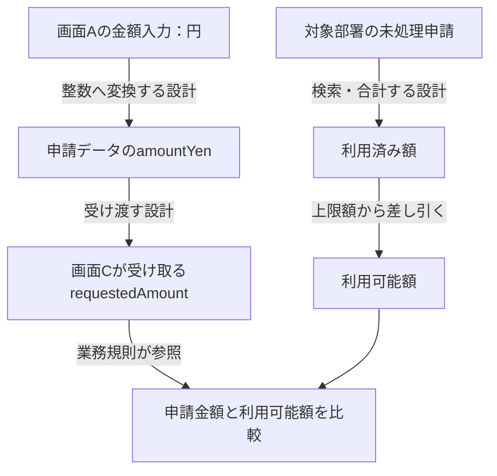

# 第13章：開発知識のモデル化

更新日：2026-10-11。執筆とレビューの状況は[README](../../README.md)で確認できる。

## この章の到達点

要件・設計・実装・テストを、根拠と版を持つ対応として整理できるようになる。画面をまたぐデータの出所をたどり、仕様の記述とコードから得た記録を照合する。

## 開発の問いから必要な対応を選ぶ

第3章の「要件R-01を変えたら、どのテストを見直すか」を開発資料へ広げる。必要なのは要件とテストの直結だけではない。どの機能やAPIを介して対応するか、誰が何を根拠に結んだかも残す。

次は架空の対応記録である。対象の版に加え、対応を結んだ根拠と確認状態を記す。

| 対応の記録 | 根拠と版・位置 | 対応の確認状態 |
|---|---|---|
| 要件R-01を機能F-01が実現する | 要件書v2 §3と設計書v3 §2の対応欄 | 設計担当者が確認済み |
| 機能F-01をAPI A-01が提供する | 設計書v3 §2のAPI一覧 | 設計担当者が確認済み |
| 関数`apply`がAPI A-01を実装する | コミットc1の`api.py`の`apply`と経路定義 | 静的解析による候補。担当者は未確認 |
| テストT-01がAPI A-01を検証する | テスト仕様v1のT-01の対象API欄 | テスト担当者が確認済み |

例えばA-01というAPIが存在する根拠と、T-01がA-01を検証する根拠は異なる。後者はテスト仕様の対象API欄で確認する。対応の作成者、確認者、確認日時などは第8章の来歴記録に残す。表の「確認済み」は対応の確認を意味し、テストの実行成功を意味しない。

シンボルは関数やクラスなどコード中の名前付き要素である。ファイルの行番号は改訂でずれるため、コードの版と要素の識別も一緒に残す。APIは表示名だけでなく、HTTPのメソッドとパス、サービスと版などで区別する。OpenAPIの `operationId` を使う場合は、その仕様内の識別値として管理する。[OpenAPI 3.1.1 Operation Object](https://spec.openapis.org/oas/v3.1.1.html#operation-object)

要件を「実現する」と、テストが「検証する」は関係の意味が違う。実装ファイルへの参照だけで検証済みにせず、テストが確かめる条件と実行結果を別に記録する。

## 業務用語・開発ルール・設計判断

業務用語には、第2章の語彙表のように定義と別名を付ける。例えば「申請金額」と「請求金額」が同じかは、画面上の名前だけで判断しない。金額の単位、税込か税抜か、いつの金額かまで確認する。

開発ルールは、対象と適用条件を持つ規則にする。「エラーを統一する」だけなら、API応答の形式なのか画面文言なのかが分からない。「サービスSのAPIの業務エラーは、応答のコード項目に所定の値を返す」と書けば、確認する範囲を絞れる。

**設計判断**には、採用した案と理由、比較した案、決めた時点を残す。例えば「再入力時には古い申請データを破棄する」という判断があるなら、理由と適用する処理を設計書へ対応付ける。グラフには判断IDと関係を置き、長い議論は原文へ参照してよい。

## 仕様と実装を分けて記録する

設計書に「通常申請はCへ進む」とあり、コードが通常申請をDへ送っていたとする。このとき、コードに合わせて仕様の関係を書き換えると、差異を発見できなくなる。

| 記録の種類 | この例で保存する内容 | 確認すること |
|---|---|---|
| 仕様としての主張 | 設計書v2は通常申請をCへ送ると定める | 現行の承認済み仕様か |
| 実装から得た記録 | コミットc1の処理は通常申請をDへ送る | 解析した分岐と呼出先は正しいか |
| 照合結果 | 仕様と実装の遷移先が異なる | 実装不備、仕様の改訂漏れ、解析誤りのどれか |

両方を残した上で担当者が差異を調べる。静的解析が呼出しや値の流れを取り出しても、動的な呼出先や解析範囲による限界がある。実行時の観測も、使った入力とコードの版を添える。[CodeQLのデータフロー解析](https://codeql.github.com/docs/writing-codeql-queries/about-data-flow-analysis/)

## 受け取るデータから入力元へたどる

序章の応用題材では、C/Dは渡されたデータを使って業務判断する。Cの設計書に「Aで入力した金額」と書かれている必要はない。テスト作成者が、項目の受け渡しと変換の設計をたどって入力元を確認する。

次は、その対応を説明するための追加の架空例である。元の題材の変換仕様を確定するものではない。

矢印は、設計上の値の受け渡しや計算への依存を表す。Aの文字列を整数へ変えるなら、その変換を残す。単位が変わる、丸める、複数項目を組み合わせる場合も、同名かどうかだけで結ばない。

DBへ保存して同じ値を読み戻すだけなら、モデル上は値の受け渡しとしてまとめられる。一方、読取り条件や計算は省かない。例えば「部署が一致し、未処理の申請だけを合計する」なら、対象部署、状態の条件、合計する列が結果を左右する。

利用済み額を固定値だけで置くと、テスト環境にその合計を作る準備が抜ける。合計される申請レコードと、除外されるレコードも確認する。第15章では、この計算から入力と準備データを一緒に考える。

## 原本・コード・実データとの境界

グラフには、すべての設計書やコードを複製する必要はない。対象ID、対応、適用条件、原文の版と位置を残し、詳しい内容は原本へ戻る方法がある。

| グラフへ残すもの | 原本や外部に残すものの例 |
|---|---|
| 要件・機能・API・テストのIDと対応 | 設計書の詳細な説明、コード全文 |
| 規則が参照する項目と条件 | 複雑な計算の実行用定義への参照 |
| 原本の版・位置、確認状態 | 版管理された文書・リポジトリ |
| テストデータの条件と準備手順の参照 | 環境ごとの実レコードと実行ログ |

外部参照先の版を固定しなければ、グラフと原文の内容がずれる。参照先を取得できない場合には、根拠を確認できないことを回答へ反映する。実データのアクセス権限も第8章の運用に従う。

## 変更影響とトレーサビリティ

**トレーサビリティ**は、要件から設計・実装・テストなどの対応を追えることである。変更した要件から見直し候補を集め、候補ごとに原文と実装を確認する。

例えば金額の単位を変えたなら、画面Aの入力、変換、Cの受信項目、比較規則、その条件を検証するテストを候補にする。対応の登録漏れがあると候補も漏れるため、既知の変更例で何が見つかるかを確かめる。

「経路がある」と「変更の影響を受ける」は同じ判定ではない。表記だけの修正なら、つながるテストの実行条件は変わらない場合もある。変更内容と対応の意味を読み、見直した結果と理由を残す。

## 復習

- 仕様と実装の関係が食い違うとき、なぜ両方の記録を残すか。
- Cが使う受信項目から、Aの入力へ何を根拠にたどるか。
- DBの読取りや集計で、値の受け渡しだけに省略できないものは何か。

## 演習と解答例

### 演習1：同名の金額

Aの「金額」は円、Cの「金額」は千円単位だった。同じ項目名なので、そのまま同じ値として結んでよいだろうか。

解答例：単位が違うため、変換仕様を確認する。円から千円へ換算する際の端数の扱いも結果を変える。入力項目・変換・受信項目を別に表し、どの設計が対応を定めるかを残す。変換が未定なら推測で補わない。

### 演習2：根拠のない対応

要件R-01から機能F-01、API A-01への対応は設計書v3で確認できた。抽出ツールは「テストT-02がA-01を検証する」という候補も返したが、その根拠位置を取得できなかった。R-01の変更時に、T-02をどう扱い、何を追加で確認するか。

解答例：T-02との対応は未確認の候補として残す。テスト仕様の版と対象API欄を取得し、A-01を検証する内容か担当者が確認する。根拠がある対応と同じ確度で見直し対象だと断定しない。対応を確認できても、変更した条件をT-02が確かめるかは別に調べる。

前：[第12章](12-ai-knowledge-use.md) ／ 次：[第14章 AIによる設計・コード生成への適用](14-design-and-code-generation.md)
