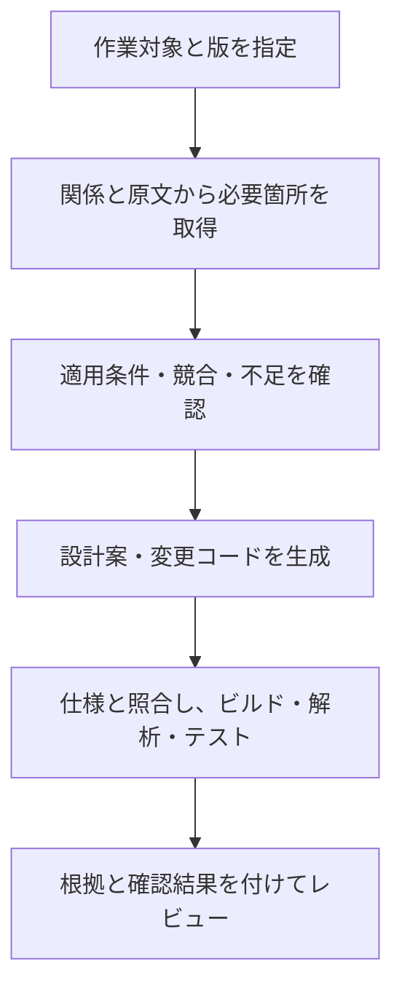

# 第14章：AIによる設計・コード生成への適用

更新日：2026-10-11。執筆とレビューの状況は[README](../../README.md)で確認できる。

## この章の到達点

実装する作業に必要な仕様と根拠を集め、AIへ渡す内容を組み立てられるようになる。仕様の不足や競合を残し、生成した設計・コードを別の根拠で確認する。

## 作業を具体的にしてから知識を集める

「申請機能を実装する」だけでは、どの版の何を変更するかが定まらない。例えば「画面Cの金額確認を、承認済み設計v3に合わせて変更する。対象はサービスSのコミットc1」と指定する。

第13章の対応を使い、画面Cの受信項目、比較する利用可能額、関係するAPI、開発ルール、既存テストを集める。関連するという理由ですべての文書を渡すと、旧版の条件や別機能の規則が混ざる。対象と公開版を決めて必要な箇所を選ぶ。

次は説明用に用意した架空の作業資料である。序章の未定義の規則を確定したものではない。

| AIへ渡す項目 | 内容の例 | 根拠 |
|---|---|---|
| 作業目的 | Cで申請金額と利用可能額を比較する | 変更依頼CH-01 |
| 入力 | requestedAmount、円単位の整数 | Cの受信設計v3 §2 |
| 規則 | 申請金額が利用可能額を超えれば申込みを受け付けない | 業務規則BR-01 v3 |
| 利用可能額 | 部署の上限額－同じ部署の未処理申請の合計 | 集計設計CALC-01 v2 |
| 開発ルール | 金額の計算には既存の共通部品を使う | 開発規約DEV-01 §4 |
| 未確認 | エラー応答のコード値 | API応答設計に記載なし |

このように作業に必要な根拠をまとめたものを、ここでは**作業用の文脈**と呼ぶ。第1章の文脈と同様に、値や記述を使う範囲が分かる情報である。文書の要約だけでなく、対象ID・版・原文位置・不足を含める。

## 取得から生成へ渡す

矢印は作業の流れを示す。検索が取り違えた仕様を渡すと、AIがその仕様に忠実なコードを生成しても、今回の変更としては誤りになる。生成前に取得内容を確認する段階を置く。

AIへの依頼には、作業範囲と変更してよい対象、根拠として使う資料、期待する出力を明記する。例えば「BR-01に対応する変更箇所とテスト案を示し、エラーコードは未確認事項として残す」とする。原文にない仕様を、コードの空欄を埋める都合で作らせない。

## 仕様が不足・競合する場合

必要なエラーコードが未定なら、その値に依存する公開インターフェースは確定できない。一方、金額比較の計算や既存コードとの対応は検討できる。不足項目と、それが止める作業を分けて示す。

| 状況 | 進められる作業 | 確認が必要なこと |
|---|---|---|
| エラーコードがない | 比較条件とテスト観点を整理する | 応答のコード値と形式 |
| 二つの現行資料で上限が違う | 出典・適用範囲・版を並べる | どの規則を採用するか |
| 仕様と実装の集計条件が違う | 条件の差と影響候補を示す | 実装不備か、仕様の更新漏れか |

検索で後から見つかった資料が優先とは限らない。例えば一般利用者の上限と職員の上限は、適用対象が違う。対象が一致するかを調べてから競合と判断する。担当者の確認結果は、次回の生成でも使えるよう出典とともに保存する。

## 生成物と根拠を対応付ける

AIが変更した関数とBR-01を結び、どの条件を実装したかを説明させる。「関連資料を参照した」だけでは、その資料のどこを使ったか追えない。

| 生成物 | 対応させる根拠 | レビューで見る内容 |
|---|---|---|
| 比較処理 | BR-01 | `>` と `>=` を取り違えていないか |
| 集計処理 | CALC-01 | 部署・状態の条件と合計対象が一致するか |
| テスト案 | 規則の境界と期待結果 | 上限と同額、その一つ上を区別するか |
| 変更説明 | 作業依頼と上の対応 | 依頼の範囲に収まるか、未確認が残るか |

根拠へのリンクは確認の入口である。コードがその条件を実装しているかは、差分とテストで確認する。行番号が変わる場合には、変更後のコミットやシンボルを対応付け直す。

## 検証を段階に分ける

ビルドは構文や型などの問題を、静的解析は設定した規則への違反や一部の不具合を見つける。単体テストは比較と集計の小さな条件を、結合テストはDBやAPIを介した対応を調べる。どの確認が何を支えるかを記録する。

例えば「利用可能額70、申請額70なら上限以内。71なら上限を超える」という期待結果は、BR-01から用意する。生成された関数の結果をそのまま期待値にすると、比較演算子の誤りをテスト側にも写すおそれがある。

同じAIがコードとテストを提案することはできるが、期待結果の根拠と検査対象は分ける。レビュー担当者は仕様の条件、境界、例外、準備データを確認する。AIが作成したという説明や、テストが通ったという一語だけで完了にしない。

検証結果には対象コードの版、入力、期待結果、実結果、実行した確認を残す。実行できなかった確認も区別する。第15章では、複数の設計をまたぐ準備データとテストを組み立てる。

## 復習

- 作業用の文脈には、文書本文のほかに何を含めるか。
- 不足する仕様があるとき、進められる作業をどう分けるか。
- 生成コード自身の結果を期待値にするのは、なぜ問題か。

## 演習と解答例

### 演習1：境界を確認する

BR-01は「申請金額が利用可能額を超える場合に受け付けない」と定める。AIは「申請金額が利用可能額以上なら受け付けない」というコードと、そのコードに通るテストを生成した。どの例で差を見つけるか。

解答例：両方が70の例を用意する。仕様では上限以内だが、生成コードは受け付けない。70と71の境界を仕様から独立に定め、比較演算子とテストの期待値を修正する。テストが通るだけでは仕様に合うと判断できない。

### 演習2：未定の応答

金額の規則は承認済みだが、エラー応答のコード値が書かれていない。AIは既存の別APIと同じ値を提案した。どのように扱うか。

解答例：別APIの値は候補として示し、今回にも適用する根拠を確認する。比較条件や変更箇所は検討できるが、応答値を確定した実装として公開するには確認が必要である。不足・確認先・影響する作業を変更説明に残す。

前：[第13章](13-development-model.md) ／ 続き：第15章「結合・システムテストへの適用」
