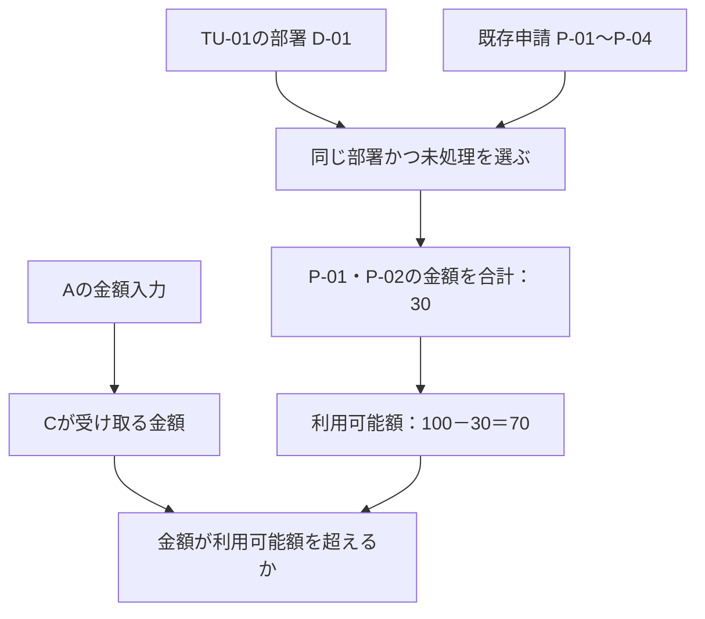

# 第15章：結合・システムテストへの適用

更新日：2026-10-11。執筆とレビューの状況は[README](../../README.md)で確認できる。

## この章の到達点

複数の設計から、権限・経路・業務条件・準備データを集め、実行可能なテストの条件を整理できるようになる。関係を検索する処理と、条件を満たす値を求める処理、実行結果を判定する処理を分ける。

## 前提をそろえてからテストを作る

序章の題材では、A〜Dに権限Yが必要であり、Aの入力に応じてBからC/Dへ進む。C/Dでは業務エラーが起こる場合もある。「Cで業務エラーを起こす」には、Cへ到達する条件と、Cの業務規則で受け付けられない条件を同時に満たす。

| 集める設計 | テストで決めること |
|---|---|
| ユーザ・権限・アクセス | 誰が操作し、各画面に入れる条件をどう満たすか |
| 画面遷移・操作 | ログイン後から目的の処理まで、どの順で操作するか |
| 入力・受け渡し・変換 | Aのどの値が、BやC/Dのどの項目へ渡るか |
| 業務規則・DB参照 | 判定に使う値、検索条件、集計、確認する時点 |
| 結果・更新 | 何を観測し、何を期待結果とするか |

設計書間の項目名が違う場合には、第13章の対応を使ってたどる。元の題材では、具体的な分岐・業務規則・ログイン後の経路などは未定である。その設定だけでは、入力値と完成した手順を確定できない。[題材の確認事項](../../examples/conditional-screen-flow.md)

## 計算できる小例を追加する

以下は、本章のために追加した架空の教材設定である。ユーザーが提示した題材の確定仕様ではない。実際の画面やAPIは用意せず、条件とデータの組合せを調べる。

| 項目 | この小例での設定 |
|---|---|
| 利用者 | テスト利用者TU-01、部署D-01、権限Yを保有。その他のアクセス条件も満たす |
| 操作 | ログイン成功後Aへ進み、入力を確定してBへ進む。C/Dで送信すると業務判定する |
| Aの入力 | 申請区分は通常・特別。申請金額は1〜150の整数、単位は円 |
| 受け渡し | 区分と金額を同じ申請の値として保持し、値を変えずにB・C/Dへ渡す |
| Bの分岐 | 通常はC、特別はD |
| Cの規則 | 金額が利用可能額を超えると業務エラー。利用可能額＝100－同じ部署の未処理申請の合計 |
| Dの規則 | 金額が50を超えると業務エラー |
| 判定と結果 | 送信直前の値を使う。エラー時は申請を登録しない。具体的な表示文言は定めない |

本章の計算中は準備データが変わらないものとする。上限と同額なら、これらの金額規則では上限以内である。実システムに他の規則があれば、別に確認する。

## 集計の結果だけでなく、レコードを準備する

Cの判定に使う準備データを次のようにする。これは既存申請の表であり、今回の申請を含めない。

| 申請ID | 部署 | 状態 | 金額 |
|---|---|---|---|
| P-01 | D-01 | 未処理 | 10 |
| P-02 | D-01 | 未処理 | 20 |
| P-03 | D-02 | 未処理 | 500 |
| P-04 | D-01 | 処理済み | 900 |

TU-01の部署D-01と、状態「未処理」の両方に一致するのはP-01・P-02である。合計は30、利用可能額は100－30＝70になる。P-03は別部署、P-04は処理済みなので合計しない。

準備レコードを省いて「利用可能額70」とだけ渡すと、DBがどの申請を選び、何を合計するかを検証できない。検索条件の漏れを見つけるために、除外されるP-03・P-04も残す。

これは値と計算の依存を示す図であり、画面の操作順ではない。DBへの保存・読戻しで値が変わらなければ、その区間を一本の受け渡しとして扱える。変換、結合、検索条件、集計によって値が変わる区間は残す。

## 条件を満たす入力を求める

目的を「Cで金額規則による業務エラー」とする。入力に必要な条件は、区分＝通常、1≦金額≦150、金額＞70である。例えば通常・85なら、BはCへ進み、Cは85＞70としてエラーになる。

このように複数の条件を同時に満たす値を探す問題を**制約充足**と呼ぶ。小例なら候補を列挙して調べられる。変数や条件が増えた場合は、条件を扱える専用の解法やツールを検討する。グラフの経路を見つける処理とは役割が違う。[AIMA公式CSP資料、スライド3〜5](https://aima.cs.berkeley.edu/slides-pdf/chapter05.pdf)

| 狙う結果 | 入力例 | 根拠となる計算 |
|---|---|---|
| Cで金額上限以内 | 通常・70 | 70≦100－30 |
| Cで業務エラー | 通常・71 | 71＞100－30 |
| Dで金額上限以内 | 特別・50 | 50≦50 |
| Dで業務エラー | 特別・51 | 51＞50 |

通常・70と通常・71は境界を比べる例であり、Cの金額規則を確かめる。「特別のままCへ進む」という条件は、この小例の分岐規則と両立しない。値が見つからなければ、都合のよい入力を作ったことにせず、両立しない条件や不足する仕様を調べる。

入力と準備データは一組にする。P-02を20から40へ変えると、利用可能額は50に変わる。同じ入力でも結果が変わるため、テストの版には準備レコードの値も残す。

## 条件から操作手順へ

手順には、TU-01でログインし、Aで通常・85を入力し、BからCへ進み、送信するという順番を記載する。実行前にP-01〜P-04を準備し、実行後に片付ける方法も決める。

各操作には、その操作を始められる条件と、終えた後の状態がある。Aの入力確定後に同じ申請の金額をCが参照すること、別利用者や前回の申請の値と混ざらないことを確認する。実行中に別申請が追加される環境なら、判定直前の集計をそろえる方法も必要になる。

グラフは、手順を組むための関連設計と条件を集める役割を担える。操作の前提と状態変化を評価して順序を求めるのは計画の処理、金額などの値を求めるのは制約充足の処理である。必要な範囲で組み合わせる。

## 期待結果とテストオラクル

**テストオラクル**は、実行結果が正しいかを判定するための根拠や仕組みである。この小例なら、承認した教材規則と準備データから計算する。実装が返した結果をそのまま正解にしない。[ISTQB CTAL-TA v4.0 §1.3.4](https://istqb.org/wp-content/uploads/sdm-uploads/ISTQB-CTAL-TA-Syllabus-v4.0-EN.pdf)

通常・85の期待結果は「Cへ進む」「送信時に金額規則による業務エラー」「今回の申請を登録しない」である。画面遷移、エラー種別、DBの更新を別に観測する。具体的な表示文言は小例でも未定なので、文字列まで確定したテストにはしない。

結合テストでは、受け渡しとDBの検索・集計が仕様どおりかを確認する。システムテストでは、ログインから送信までの操作と結果を確認する。純粋な条件計算が正しくても、この二つを実行した証拠にはならない。テストレベルの区分は[ISTQB CTFL v4.0.1 §2.2.1](https://istqb.org/wp-content/uploads/2024/11/ISTQB_CTFL_Syllabus_v4.0.1.pdf)を参照できる。

[条件計算の実行例](../../examples/screen-flow-constraints/README.md)では、上の準備データ、境界の四例、条件が両立しない例を確認する。画面・API・DBへの接続は実装していない。

## 復習

- Cへの経路とCでの業務エラーを同時に満たすには、何を集めるか。
- P-03とP-04を準備データに含める理由は何か。
- 関係検索、計画、制約充足、結果判定はそれぞれ何を担当するか。

## 演習と解答例

### 演習1：準備データを変えた

P-02の金額を40に変更した。ほかの値は同じである。通常・51を入力した場合、どこへ進み、金額規則ではどうなるか。

解答例：通常なのでCへ進む。同じ部署の未処理合計は10＋40＝50、利用可能額は100－50＝50である。51＞50なので業務エラーになる。別部署の500と処理済みの900は合計しない。

### 演習2：実行できたと言えるか

条件計算のプログラムで通常・85がCの業務エラーになると確認した。システムテストを完了したと言えるだろうか。残る確認を挙げよう。

解答例：言えない。実環境のユーザ・権限、準備レコード、入力の受け渡し、分岐、送信時の参照、エラーと登録結果を観測する必要がある。計算例はモデルの条件を確かめたものであり、実装の動作確認とは分ける。

前：[第14章](14-design-and-code-generation.md) ／ 次：[第16章 効果を評価する](16-evaluation.md)
