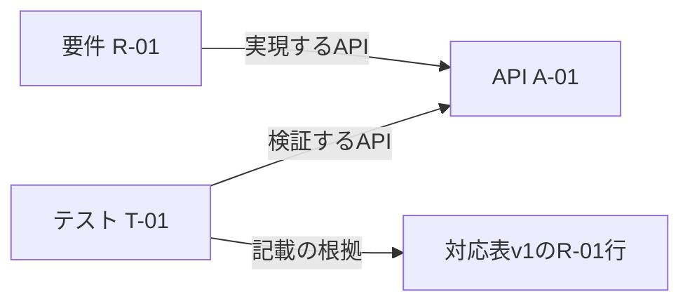

# 第17章：小さく始めて発展させる

更新日：2026-10-11。執筆とレビューの状況は[README](../../README.md)で確認できる。

## この章の到達点

小さな原本から知識を作り、問い合わせ・制約検証・更新を一巡できるようになる。AIへ渡す根拠の作り方を確かめ、次に広げる範囲を評価する。

## 一つの問いと小さな原本から始める

実習の問いは「要件R-01に対応するAPIを検証するテストは何か」とする。本章は独立した架空の実習であり、要件・API・テストのIDは本章内だけで使う。前章までの同じIDとは別の対象で、序章の権限に関する要件を改訂した例ではない。

| 要件ID | 要件の名称 | API ID | テストID |
|---|---|---|---|
| R-01 | 通常申請を受け付ける | A-01 | T-01 |
| R-02 | 特別申請を受け付ける | A-02 | T-02 |

最初は手作業で、要件・API・テストを別々の対象にする。要件からAPIへ「実現するAPI」、テストからAPIへ「検証するAPI」を結び、元の表の行も参照する。第13章の広いモデルのうち、この問いに必要な部分だけを扱う。

図は記録する関係の向きである。検索ではR-01からAPIへ進み、そのAPIへ向かうテストの関係を逆向きに探す。T-01が見つかっても、テストを実行したという意味にはならない。

## 実習ファイルと実行する範囲

[開発対応の実習](../../examples/development-practice/README.md)に、原本・問い合わせ・制約・実行プログラムを保存した。Python 3.12、RDFLib 7.1.4、pySHACL 0.30.1を使う。導入方法は実習READMEで確認できる。

| ファイル | 役割 |
|---|---|
| sources/trace-v1.md | 最初の対応表 |
| sources/trace-v2.md | R-01のテストをT-03へ差し替えた対応表 |
| related-tests.rq | 要件からAPIを介してテストと根拠を取得する |
| shapes.ttl | 各テストに根拠のIRIを一つ以上記載する制約 |
| practice.py | 表から構築し、問い合わせ・検査・更新を確かめる |

実行例はローカルファイルだけを使い、外部AI・DB・MCPへ接続しない。実習は知識の構築と利用の接続を確かめるものであり、AIによる実装や実システムのテストを完了するものではない。

## 問い合わせと制約検証を試す

最初の版を問い合わせると、R-01に対してA-01、T-01、原本のR-01行が返る。名前の似たT-02は、A-02を検証するため結果に入らない。

次に「テストの根拠を記載する」というSHACL制約を検査する。正常なデータでは適合する。T-01から根拠の関係だけを削ったデータでは、T-01を対象とする違反になる。テストの存在や実行の成否を調べる検査ではない。

制約に通ることと、原本の行が対応を正しく説明していることも別に確認する。実習では根拠を意図的に同じ表へ固定しているが、実用では第8章の内容の照合と承認が必要になる。

## 抽出を自動化し、手作業と比べる

実行プログラムは、この実習の四列のMarkdown表だけを読む小さなパーサを使う。手作業で期待した対応と、構築したグラフを比べる。表の形式とIDの書式を限定し、読めない行があれば失敗として止める。

このパーサは一般の設計書を理解するものではない。注記・結合セル・自由文を持つ資料へ広げる場合には、第7章の構造の保持と候補確認を追加する。初期の手作業の結果を、抽出を評価する基準にできる。

LLM抽出を試す場合も、同じ原本と期待する項目を使う。「対象ID、関係、原文位置、未確認事項を出し、原文にない対応を補わない」と依頼する。実行例にLLM呼出しは含めていないため、精度や費用は実測していない。

## AIへ渡す根拠を作る

問い合わせ結果から、要件ID・API・テスト・原文位置・公開版をまとめる。プログラムはこの内容をJSONへ出力し、第12・14章の作業用の文脈の入口にする。

AIへは例えば「この根拠からR-01の見直し候補を説明する。実行済みとは書かず、記録にない対応は未確認とする」と依頼できる。原文の該当行も渡し、生成回答が対応と版を保つかを確認する。

接続を試す段階では、原本をそのまま渡す方式と、このJSONと原本位置を渡す方式を同じ問いで比べる。第16章の基準で、根拠の正しさ、回答の不足、総確認工数を測る。JSONを作れたことだけをAI連携の効果としない。

## 更新と撤回を確かめる

対応表v2では、R-01のテストをT-01からT-03へ変更する。プログラムはv2から新しいグラフを作り直し、R-01の現行の結果がT-03だけになることを確認する。v1の結果と混ぜず、出典もv2へ変える。

v1は過去の説明を再現するために残せるが、現行版の検索へ無条件に足さない。追加だけで更新すると、取り消されたT-01が候補に残る。本実習は全件を作り直す方式であり、差分更新の実装は含めない。

## 次の範囲を選ぶ

試行の結果を、確認できた問いと残った問題でまとめる。次に増やすのは、対象資料、問い、抽出方法、推論、実行のどれか一つからでよい。複数を一度に変えると、品質が変わった原因を調べにくい。

| 発展テーマ | 追加する内容 | 先に確認すること |
|---|---|---|
| モデルベーステスト | 状態・操作からテストを導く | モデルの状態と実装の状態が対応するか |
| 制約充足 | 複数条件を満たす入力と準備データを求める | 第15章の境界・両立しない条件を再現するか |
| 時間を扱う知識 | 適用期間を指定して答える | 取得日時と有効日時、同時点の矛盾を区別するか |
| 日常運用 | 承認、更新、撤回、アクセス制御 | 古い版や制限された根拠が回答へ漏れないか |

小さなモデルで問いに答えられるなら、その形を基準にする。用途が増えたときに定義と検査を追加し、必要な形式化の深さを選ぶ。

## 復習

- 手作業のモデルを、自動抽出の確認にどう使うか。
- 根拠を持つという制約が通っても、まだ確認すべきことは何か。
- v2の取り込みで追加だけを行うと、どの誤りが起こるか。

## 演習と解答例

### 演習1：別のテストも候補にする

T-04もA-01を検証すると原本へ追加したい。どの記録と検査を増やすか。

解答例：T-04を別のテストとして識別し、A-01への検証関係と原文位置を追加する。R-01の問い合わせがT-03・T-04を返すことを期待結果にする。現在の実習パーサは要件の行を一行に限定するため、そのまま重複行を入れず、複数のテストを表す原本形式とパーサも改訂する。

### 演習2：回答だけ古い

v2の問い合わせではT-03が返るが、AIへの回答資料にT-01が残った。何を確認するか。

解答例：JSONの作成元の版、検索結果の保存、回答キャッシュ、渡した原文を確認する。グラフの更新だけでなく、AIへ渡す作業用の文脈も同じ公開版へそろえる。現行の問い合わせが正しいだけでは、最終回答の更新まで確認したことにならない。

前：[第16章](16-evaluation.md)
